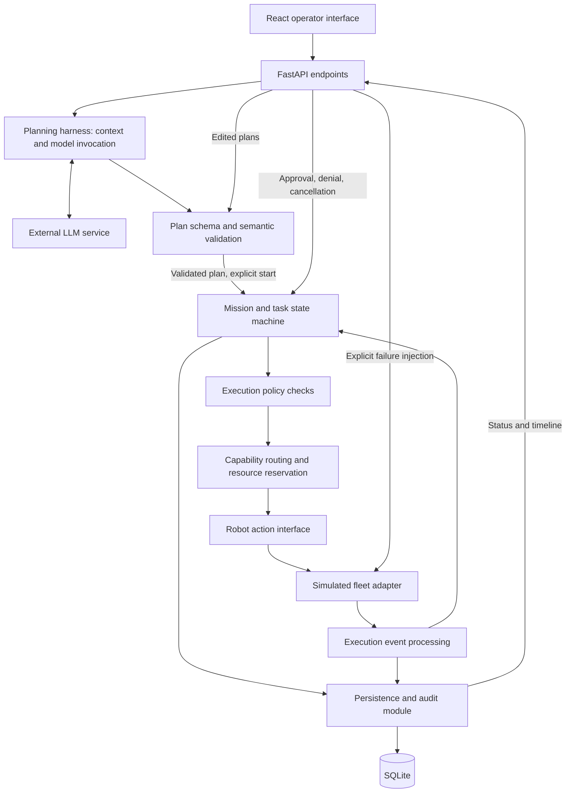

# IAC Mission Orchestrator: Implementation Handover

## 1. Purpose and current state

This document hands implementation to the next coding agent. Build a working, reviewable orchestration prototype from the requirements below. Do not treat proposed implementation details as additional assessment requirements.

- Repository: https://github.com/zhonghe0615/iac-mission-orchestrator (private).
- Local workspace used during planning: `/Users/harvie/Documents/ChatGPT/IAC`.
- Baseline: `5461f8c`, containing only README and ignore rules. No application, dependencies, tests, or model integration exist yet. This handover is added after that baseline.
- Source assessment: `IAC_Orchestration_Assessment.pdf`, three pages. Local source path: `/Users/harvie/Desktop/IAC/IAC_Orchestration_Assessment.pdf`. The PDF has not been uploaded to the repository. A cloud environment may not have this file; the essential requirements are transcribed below.
- No credentials are stored in the repository. The owner will provide model credentials separately.

## 2. Confirmed owner decisions

- Frontend: React and TypeScript. Backend: Python and FastAPI. Database: SQLite.
- All documentation and code comments must be in English. Communicate with the owner in Chinese. Use English for the product UI as proposed during planning.
- The owner's intended model is named **GPT6 Luna**, with reasoning enabled when needed. This is a requested model name, not a verified API model identifier. Confirm provider access, the actual API identifier, and supported reasoning parameters before integration. Do not invent them or silently substitute a different model.
- Credentials will arrive later. Continue independent implementation with an explicitly labeled mock planner, then verify real model integration when credentials are available. A mock-only submission is insufficient.
- Aim for a deliverable the owner is satisfied with, beyond the assessment's suggested 6-8 hours if needed. The owner initially set an approximately 12-hour total budget, then clarified that exact time accounting should not distract from doing each necessary step properly. Keep scope disciplined; do not interpret this as unlimited scope.
- All repository work belongs to personal account **zhonghe0615**. Do not create repositories or publish project material under any other account.

## 3. Assessment requirements

### Business context

IAC coordinates heterogeneous robots in existing industrial facilities. The orchestration layer sits above robot integration, OEM fleet managers, sensors, and facility systems. It owns mission planning, workflow execution, task assignment, resource coordination, approvals, exception handling, and operational visibility.

The key boundary is between AI proposing work and deterministic software deciding what is permitted and what executes next. Robot-local motion control and physical safety mechanisms belong below this layer.

### Required fleet

| Robot | Assessment capabilities |
| --- | --- |
| Scout A | Navigation, camera, thermal inspection |
| Scout B | Navigation, camera, thermal inspection |
| Mobile Manipulator C | Inspection and simulated repair |

Define concrete action schemas, durations, observations, and failure behavior. These are implementation assumptions, not additional facts about real hardware. All robot execution may be simulated; no ROS, hardware, 3D simulator, or complex physics is required.

### Required mission

1. An operator submits a plain-English work order to inspect and resolve a suspected tank defect.
2. A real LLM produces a structured, capability-aware mission plan. The operator can inspect or edit it before execution.
3. The orchestrator selects an eligible inspection robot, executes simulated inspection, and records observations and evidence.
4. Findings can trigger a high-risk repair request. Explicit operator approval is required before repair. Approval and denial must produce different outcomes.
5. Following approval, Mobile Manipulator C performs simulated repair, followed by verification and completion of the mission record.
6. Inject a failure, such as Scout A going offline or an action timing out. Demonstrate appropriate retry, reassignment to Scout B, or escalation without silently losing mission state.

### Required product surface

- Web UI: submit a mission; review its plan; view robot availability; track mission/task status and a live event timeline; approve/reject a step; inject a failure.
- Backend: reusable mission/task model, capability-based routing, explicit execution state machine, and simulated robot action/event adapter.
- Meaningful agent integration: real LLM use for at least one decision-support step, with structured output and validation. Replay/mock mode is useful but cannot be the only planner behavior.
- Basic tests: success, approval denial, and failure/recovery. Document at least one unhandled edge case.
- Agent output must not bypass execution rules or directly issue unrestricted low-level robot commands. Simulated repair must be gated by policy and human approval.

### Required delivery artifacts

- Approximately 2-4 pages of technical design explaining architecture and tradeoffs.
- Source repository and README with setup, launch, and clear simulated-versus-implemented boundaries.
- A 3-5 minute demo video **or** live walkthrough covering planning, execution, approval, failure, and recovery. A repeatable walkthrough and script are the proposed default; a recorded video has not been explicitly selected.
- Brief AI-tool usage disclosure describing what tools accelerated and which choices received human engineering judgment. Record actual use; do not invent a history of human decisions.

The design must also address system contracts, production reliability and governance, build-versus-buy decisions, first 30/60/90-day priorities, and collaboration with integration engineers, field teams, customers, and sales/solutions teams.

Durable restart/replay, concurrent resource contention, out-of-order events, and metrics are assessment bonuses. Basic repair authorization is mandatory even though additional policy sophistication is optional.

## 4. Proposed implementation architecture

Use a single backend service with internal modules, not microservices. This is the planning recommendation; refine details when implementation evidence justifies a simpler or safer approach.

### Ownership and external dependencies

We implement the UI, API, planning harness, domain models, validation, policy enforcement, state transitions, routing, persistence logic, audit trail, and simulator. The LLM service and database engine are dependencies. Frameworks provide infrastructure; they do not define our mission semantics.

Real enterprise work-order systems, Robot Integration Layer implementations, OEM fleet managers, sensors, and hardware remain outside prototype scope. Define their conceptual contracts in the design, not full integrations.

### Planning harness

- Supply a bounded site context, supported action catalog, and robot capabilities.
- Generate a structured candidate plan, validate it, and give bounded correction feedback or a clear error.
- Record planner mode and relevant call outcomes. Never silently replace a failed real LLM call with a successful mock result.
- Initial planning is sufficient; autonomous replanning is not required for the first slice.
- MCP is not required. Passing context directly to the model is sufficient initially. Keep robot execution behind the orchestrator rather than exposing an unrestricted repair tool to the model.

### Execution core

- Validate both model-generated and operator-edited plans. Reject unsupported actions, invalid arguments, missing dependencies, cycles, and unsafe sequencing.
- Recheck runtime eligibility before dispatch; plan-time availability can become stale.
- Enforce repair approval in backend code, independent of model assertions or UI controls. Bind approval to the relevant plan version and action. Relevant edits invalidate prior approval.
- Route through capability requirements rather than hardcoding Scout A into workflow logic. A deterministic preference for A can make the failure demo reproducible when A and B are both eligible.
- Reserve a robot while an action is active. Start with clear behavior for unavailable resources; broad multi-mission scheduling can follow later.
- Maintain explicit timeout, cancellation, and recovery semantics. A cancellation request does not prove the physical action has stopped.
- Persist state and audit events consistently. Basic restart recovery is a proposed quality target, not a claim that full workflow replay is already implemented.

### Robot interface and simulator

Define typed commands and results for navigation, camera inspection, thermal inspection, simulated repair, verification, status queries, and cancellation as needed. Document any capabilities assumed for verification or movement beyond the assessment's explicit catalog.

Use mission/task/attempt identifiers to correlate commands and events. The simulator must receive real backend commands and emit results or failures through the same event-processing path. The UI must not animate a predetermined success story independent of backend execution.

## 5. Minimum domain concepts and invariants

These are suggested concepts, not a requirement for one class or table per row.

| Concept | Minimum information |
| --- | --- |
| Mission and plan version | Work order, target, validated plan, lifecycle status, timestamps |
| Task | Action, arguments, capability requirements, dependencies, condition, status |
| Execution attempt | Task, robot, command correlation ID, attempt number, timeout, outcome |
| Robot | Capabilities, availability, active reservation |
| Approval | Relevant plan version and action, decision, actor, timestamp |
| Evidence | Source task/attempt, observation, simulated provenance |
| Event | Correlation IDs, event type, timestamp, payload, deduplication identity |

Define the transition table before implementation. Distinguish mission, task, and attempt state so that a failed attempt can be retried without erasing history.

Required invariants:

1. No repair dispatch without valid approval for that action and plan version.
2. Denial cannot produce successful repair or a misleading "defect resolved" outcome.
3. Dispatch requires matching capability and available capacity.
4. A task runs only when its dependencies and conditions permit it.
5. Reassignment preserves previous attempts and evidence.
6. A late result from a superseded attempt cannot overwrite the current attempt's outcome.
7. A timeout means the result may be unknown; it does not prove that no physical action occurred.
8. Mission success requires the relevant verification to succeed.

For a repair with an unknown result, query status or pause for intervention. Do not blindly retry a potentially completed physical action. For the first recovery demo, inject a clearly failed inspection attempt that is safe to repeat; describe the distinction from ambiguous network loss.

## 6. Implementation milestones and checks

### A. Contracts and executable foundation

Create backend/frontend scaffolding, configuration examples without secrets, domain schemas, and a transition table. Define a minimal fixed site and defect scenario. Document assumptions such as target identifiers, inspection findings, and denial outcome.

Check: both apps launch; a valid plan can be represented; invalid actions and dependency cycles are rejected.

### B. Deterministic mission execution

Implement persistence, simulated fleet, dispatch, evidence, repair gating, verification, and terminal outcomes. Use a clearly labeled deterministic planner fixture while credentials are unavailable.

Check: success and denial execute through the backend; direct API requests cannot bypass approval; state and audit records agree.

### C. Failure and recovery

Implement a reproducible Scout A inspection failure, eligible reassignment to B, and explicit waiting/escalation when no replacement is available. Correlate attempt results. Define restart and unknown-action behavior.

Check: failure recovery preserves the mission and history; late A events cannot incorrectly finish B's active task; unknown repair outcomes do not trigger duplicate repair.

### D. Real planning integration

Verify provider/model configuration when credentials arrive. Implement structured plan generation, validation, bounded correction, and clear error reporting. Revalidate edited plans. Real and mock modes must be visible.

Check: at least one actual model-generated plan completes the workflow; malformed or unsafe output is blocked. If credentials are still unavailable, explicitly report this as an unmet acceptance criterion rather than claiming completion.

### E. Operator interface

Connect mission submission, plan review/editing, robot availability, status, evidence, approvals, and live timeline to backend state. Include explicit failure controls in the simulator UI. Choose a simple update transport appropriate to this prototype.

Check: the user can explain what is happening, why execution is waiting, and what action is needed without reading backend logs. Refreshing the page preserves the visible mission through backend persistence.

### F. Delivery verification

Run meaningful tests and the walkthrough from documented setup instructions. Finish the short design, known limitations, demo script, and AI-use disclosure. Update README to reflect actual implementation, not promises.

Check: success, denial, and failure/recovery can all be reproduced. Mark each requirement as verified, incomplete, or intentionally deferred with evidence.

## 7. Acceptance scenarios

| Scenario | Observable acceptance criteria |
| --- | --- |
| Approved repair | Submit work order; obtain and review a real model plan; run inspection; show evidence; pause for approval; approve; C repairs; verification succeeds; mission completes with timeline |
| Denied repair | Reject the pending repair; no repair command is dispatched; mission clearly records rejection and unresolved work |
| Inspection recovery | Inject A failure during inspection; persist failed attempt; choose B if eligible; continue the original mission; retain both attempts |
| No available replacement | Recovery cannot choose B; show explicit waiting or escalation with a reason; no false completion |
| Invalid or unsafe plan | Invalid model output or edited plans are blocked before execution; omitting an approval node cannot bypass runtime repair checks |
| Duplicate or stale result | Repeated event does not repeat transitions; superseded attempt result does not corrupt current state |
| Restart quality target | Restart backend during approval waiting; recover the mission and decision context. Running ambiguous actions require reconciliation rather than automatic redispatch |

Keep tests focused on behavior and invariants. The first three scenarios are the assessment's basic test categories; remaining cases support the reliability design and proposed quality targets.

## 8. Scope control and unresolved details

- Do not build real robot drivers, 3D visualization, complex physics, a general-purpose agent framework, or a broad enterprise integration platform.
- Proposed default: a small custom state machine with persisted state. Temporal/LangGraph are optional, not assessment requirements. Explain the prototype tradeoff and what would change for production.
- Defer automatic replanning and complex multi-mission contention until the required vertical slice works.
- Do not claim production-grade safety, authentication, durability, or exactly-once physical execution. Document demo identity assumptions and production access-control requirements.
- Provider credentials, exact model ID, reasoning support, and real integration validation remain pending.
- Exact task states, API routes, action schemas, dependency versions, UI layout, and simulation fixtures are implementation decisions. Resolve routine reversible details without repeatedly asking the owner.
- Ask only for missing credentials or choices that materially change scope, cost, access, or the agreed behavior.

## 9. Working and repository conventions

- Inspect the checkout and applicable instructions before editing; preserve unrelated user changes.
- Keep implementation small and changes traceable to requirements. Avoid speculative abstractions or unrelated cleanup.
- Make focused commits and use `codex/` as the default prefix when creating a branch unless the owner requests another name. Never force-push or modify global Git settings as a shortcut.
- Verify the repository owner before any remote write. Use the personal account, not the work account.
- The current local checkout uses repository-local HTTPS rewrite and credential-helper settings because a global configuration rewrites GitHub HTTPS URLs to SSH. These settings are not carried by a clone; configure authentication appropriately in the execution environment without copying secrets.
- If a pull request is appropriate, report its URL and validation evidence. Do not merge or deploy without authorization.
- Report what was actually tested, what is inferred, and what remains unverified. Include residual limitations in the final handoff.
